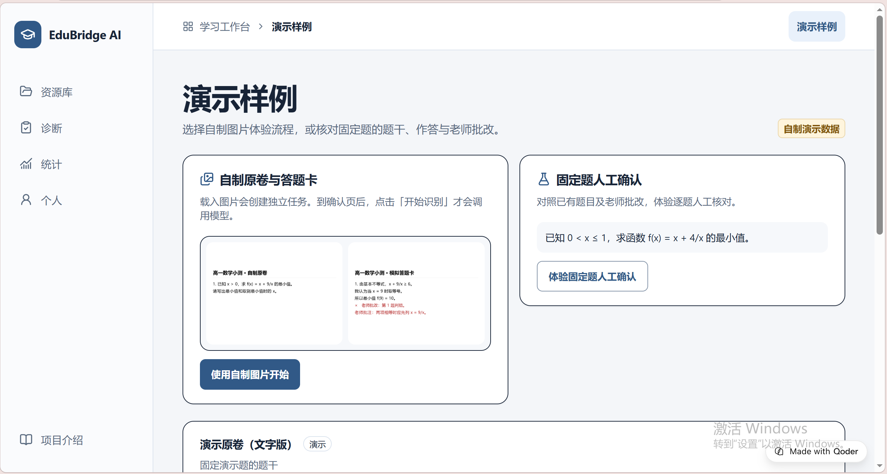

# EduBridge AI｜从试卷识别到错题复测

面向高一数学的错题复盘工作台。上传老师已批改的试卷和答题卡，核对 AI 识别结果，再根据学生的实际解题步骤生成错因假设、针对性练习、教学讲解和变式复测。当前覆盖集合、函数和基本不等式。

[在线演示（免登录）](https://edubridge-ai-7m9lo2rrc2g.qoder.zone/#/demo) · [功能验收](docs/FINAL_FUNCTIONAL_ACCEPTANCE.md) · [UI 重构与回归](docs/UI_REFACTOR_REGRESSION.md)



**我负责的工作**包括定义错题复盘流程和证据规则、设计人工确认与审核门槛、组织全局 UI 重构、排查题号匹配和数学核验超时，以及完成公网发布与功能验收。项目以 Qoder CN 辅助开发，Codex 参与代码核对与回归验证。

## 体验与系统流程

打开演示页可直接选「固定题人工确认」，对照题干、学生作答和老师批改。选「使用自制图片开始」可从图片识别走到学习报告。


## 技术栈

| 层级 | 技术 | 用途 |
| --- | --- | --- |
| 前端 | React、TypeScript、Vite、Tailwind CSS、KaTeX | 学习工作台、跨页原图核对、错因证据展示、复测与数学公式渲染 |
| 服务端 | Qoder Sites Functions（Deno）、Zod、Qoder Sites 数据库与私有存储 | 接口与数据校验、匿名会话归属、多页材料存储、学习阶段和版本管理 |
| 模型接入 | 阿里云百炼、OpenAI 兼容 API | 通过服务端完成图片识别、诊断生成与独立审核，服务端管理凭据与任务调用预算 |
| 数学核验 | Python、FastAPI、Uvicorn、SymPy、阿里云函数计算 | 对受支持的结构化命题做符号求解，隔离计算并限制执行时间 |
| 构建与验证 | TypeScript 检查、Node.js 回归脚本、Python unittest | 验证识别匹配、学习链路、接口行为和数学边界条件 |

## 工程难点与解决方案

| 难点 | 处理方式与结果 |
| --- | --- |
| **跨页 OCR 产生不同粒度的题号**。试卷只印第 7 题，答题卡分列 7(1)、7(2)，还可能出现全角括号或多级编号。 | 统一题号格式并优先精确匹配。只有父题唯一且小问标记明确时才提取子题和共享条件，分别保留每个小问的作答与批改。歧义留给人工核对。公网双页样例成功配对两个小问。见 [题号合并实现](web/functions/question-merge.mjs)。 |
| **SymPy 核验偶发超时**。测得重复启动进程的主要固定开销来自导入 SymPy，通用不等式求解也进一步延长耗时。 | 复用最多两个可终止的隔离进程，分别限制启动和求解时间。常见有理不等式采用等价的精确求解，保留定义域、极点与端点检查。本机隔离基线约 4.58–4.76 秒，热调用约 0.07 秒。见 [数学服务](math_service/main.py) 与 [验收测量](docs/FINAL_FUNCTIONAL_ACCEPTANCE.md)。 |
| **生成内容需要可追溯，审核响应也可能截断**。 | 用学生原步骤或题设条件约束错因假设，将独立审核和核验结果绑定到内容版本。修复百炼地域端点的审核参数兼容问题并调整输出预算。独立审核通过且适用命题核验通过后才能自动发布。待审核内容保留草稿和作答，人工复核单独记录。题目接口在提交前过滤私有答案。见 [学习流程服务端](web/functions/learning-routes.mjs)。 |
| **同一任务要容纳原卷、作答图、识别结果和证据**。 | 统一导航、按钮和状态反馈，用 Bento 卡片组织任务与统计。材料页分开管理原卷与答题卡，确认页保留原图对照。公式继续由 KaTeX 渲染。见 [UI 重构与回归](docs/UI_REFACTOR_REGRESSION.md)。 |

## 交付与验收

- **本地验证**涵盖多页识别与匹配 56 项、学习流程 125 项、HTTP 冒烟 105 项、SymPy 准确性 9 项，均通过。学习流程回归使用模型测试替身，可在无付费模型调用的情况下重复运行。
- **公网验证**使用双页自制原卷和一页答题卡，通过实际部署的 HTTP 接口验证从上传、识别和确认到诊断、练习、讲解、复测与报告的链路，两次验收各调用模型 8 次。完整浏览器交互仍待复验。详见 [最终功能验收](docs/FINAL_FUNCTIONAL_ACCEPTANCE.md)。
- **产品边界**保留老师批改作为原始依据。错因仍是带证据的假设，数学核验只覆盖支持的命题，复测结果只反映本次作答。

## 本地运行

需要 Node.js 22.13+（22.x）或 24+。首次在 `web` 目录安装依赖。

```sh
cd web
npm ci
```

在两个终端的 `web` 目录分别运行模拟服务与前端。

```powershell
# 终端一
$env:EB_MOCK_MODEL = '1'
npm run dev:function
```

```sh
# 终端二
npm run dev
```

打开 Vite 地址，从「演示样例」载入内置图片。模拟服务在内存中保存任务与素材。真实模型、数学服务和部署配置见 [Web 与服务端说明](web/README.md)。

## 代码与验证

| 路径 | 内容 |
| --- | --- |
| [web/src](web/src)、[web/pages](web/pages) | 前端工作台、材料核对、诊断、练习和复测 |
| [web/functions](web/functions) | 任务与会话接口、识别匹配、模型编排与审核 |
| [math_service](math_service) | FastAPI 与 SymPy 验证服务 |
| [web/dev](web/dev) | 本地适配器、回归脚本与自制测试材料 |

从仓库根目录运行核心回归，前端发布产物通过 `cd web` 后运行 `npm run build` 生成。

```sh
node web/dev/learning-flow-test.mjs
node web/dev/multipage-recognition-test.mjs
node web/dev/recognition-modes.mjs
node --experimental-strip-types web/dev/workspace-progress-test.mjs
node web/dev/run-schema-check.mjs
```

数学服务的安装与测试见 [Math Service](math_service/README.md)。第三方模板与组件许可见 [来源说明](web/PROVENANCE.md)。
